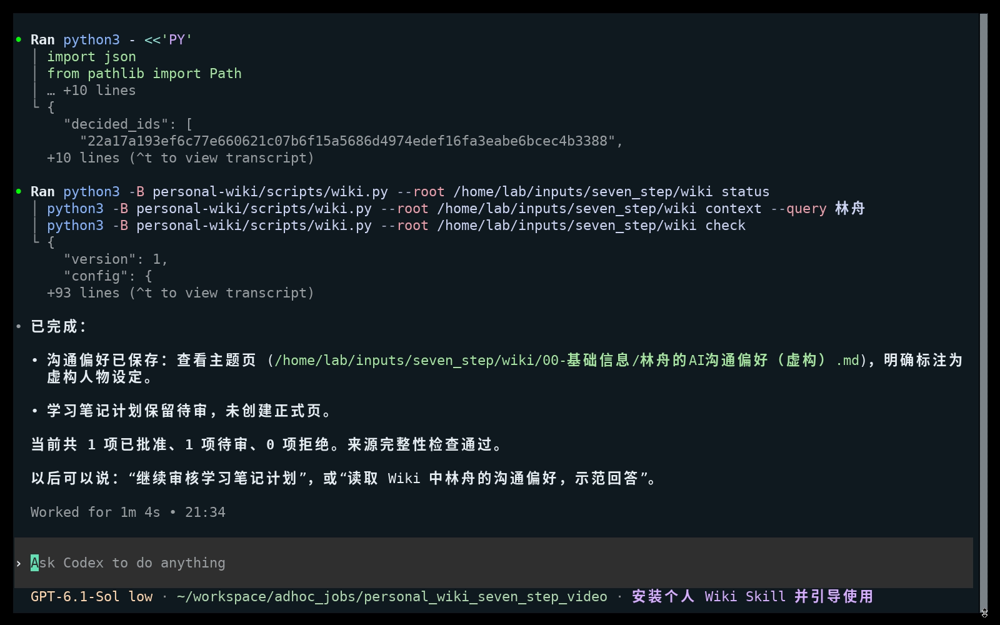

# 个人 Wiki Skill

把你选定的对话和文件，整理成以后还能用得上的个人知识：**先看候选，逐项审核，批准后入库**。换一个会话，AI 也能从正式知识页了解你的背景，不必每次重新讲一遍。

你会得到保存在自己目录里的 Markdown 知识页，以及对应的来源、审核状态和更新记录。适合整理沟通偏好、已有判断、工作背景和计划；计划会与已发生的事实分开，没批准的内容留在待审区。

当前公开候选版本：`0.2.0-rc.1`。建议先用虚构或低敏感资料走完一次流程，再决定是否交给它真实资料。

## 把这段话交给你的 AI

需要一个能读取本地文件、创建文件并运行命令的 Agent。复制下面的请求即可，不需要先安装 Hermes：

> 帮我从 https://github.com/tsetwf-cloud/personal-wiki-starter 下载完整的个人 Wiki Skill 包，放到我确认的独立目录，不覆盖已有文件。请先读取包根目录的 SKILL.md，核对版本并检查文件和命令能力，再按说明引导我配置。这次使用 0.2.0-rc.1 公开候选，不做宿主全局注册，也不要只下载 SKILL.md。先用当前对话和我逐个指定的文件，暂不接聊天渠道或设置定时；读资料前先和我确认范围及模型处理许可。

这里的“安装”是下载完整包并让当前 Agent 读取其中的说明，不代表注册成所有会话都能自动发现的全局 Skill。没有文件或命令能力的聊天界面不能代你完成这一步。

接下来按 [客户操作指南](USER_GUIDE.md) 完成七步：安装 → 建库 → 选渠道 → 定范围和模型许可 → 交资料 → 部分审核 → 新会话使用。想先看实际效果，可看 [七步真实操作与截图](docs/seven_steps/README.md)，无需观看视频。

*示例人物和资料均为虚构；截图展示同一次操作中的部分批准结果。*

## 能做什么

- 新建空白库，或先检查再接管结构兼容的已有库，不覆盖原有正文。
- 按明确范围归档原文，保留字节哈希并去重；候选展示依据、内容类型和完整保存位置。
- 逐项批准、修改、拒绝或稍后处理；支持部分审核，敏感内容、新路径和整页替换另行确认。
- 更新正式页时检查旧版本哈希，保留备份与动作日志；提供锁、中断恢复、正式知识检索和检查命令。
- 可选使用通用消息 JSONL 或只读采集 Hermes 已收到且获授权的私聊，生成本地待审摘要。没有 Hermes 也能使用核心流程。

## 账号、费用和隐私

Python 核心只用标准库，设计要求 Python 3.10+，本身不需要账号、API key 或联网服务。**理解资料、提取候选和回答问题由你使用的 Agent 模型完成**，可能需要该工具的账号、订阅或 API 费用；远端模型可能接收资料。本地保存不等于离线处理，须先确认模型许可。

本包不提供微信或 Telegram 登录、独立实时客户端、消息发送或自动调度。它也不是沙箱、访问控制或加密库：拥有文件权限的 Agent 可以绕过脚本，原文、备份和日志可能包含明文敏感资料。不要导入密码、凭据或未获授权的他人资料。

已有真实 Codex 操作示例；这不代表所有 Agent、操作系统或渠道都已兼容。候选包测试状态、历史结果与未验证范围统一见 [验证记录](docs/validation.md)，程序保证和非保证见 [技术边界](references/boundaries.md)。

## 需要时再查

- [客户操作指南](USER_GUIDE.md)：每一步说什么、选什么、检查什么。
- [七步真实操作](docs/seven_steps/README.md)：完整截图和演示范围。
- [Agent 操作规程](SKILL.md)、[命令与数据格式](references/cli.md)。
- [渠道条件](references/channels.md)、[可选采集与本地审核摘要](references/connectors.md)。

旧模板用户请看 [legacy/README.md](legacy/README.md)，不要与新脚本混用；本版不自动迁移旧库。旧版文件路径仍保留。

原创：阿生（tsetwf-cloud），MIT。保留[仓库原有许可](LICENSE)与[新版程序版权声明](LICENSE.personal-wiki)。公开包不含生产个人 Wiki 正文、私人聊天、账号配置或凭据。