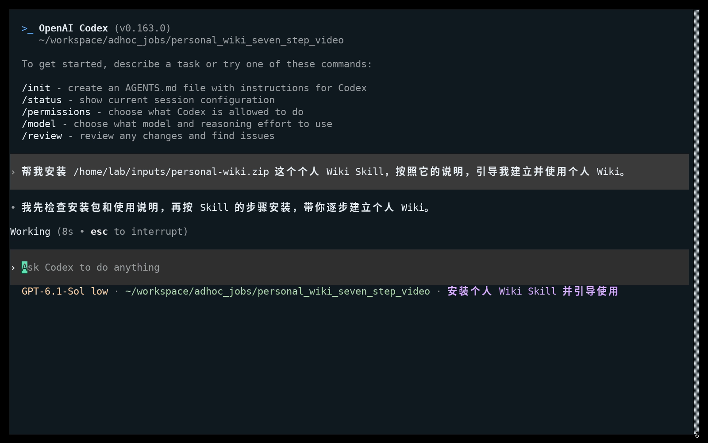
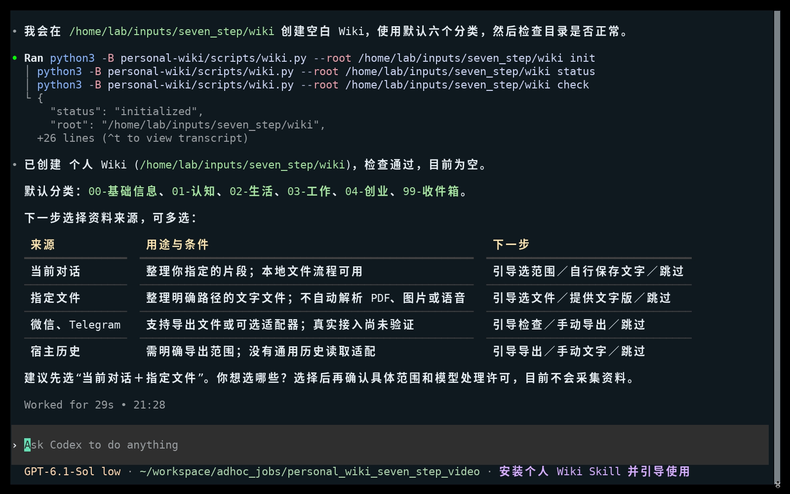
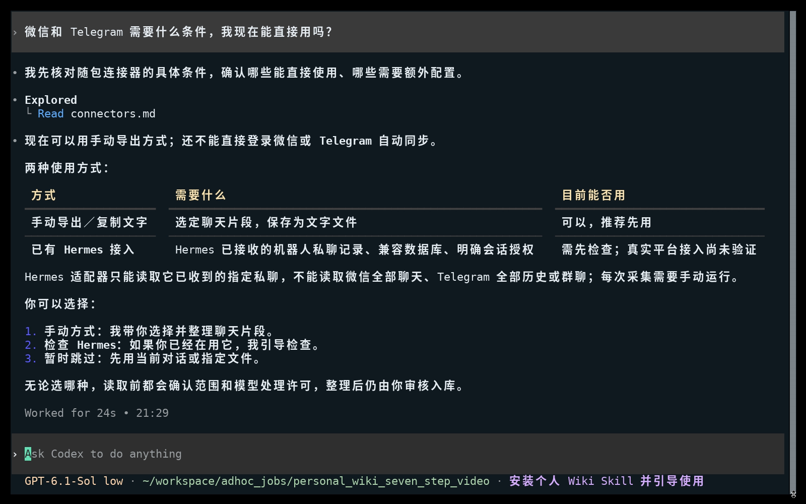
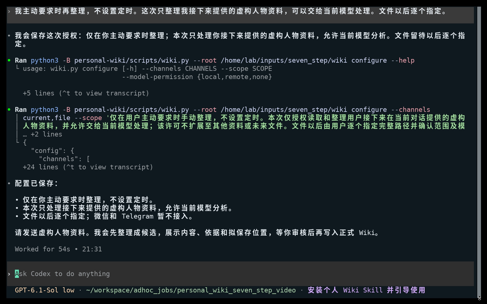
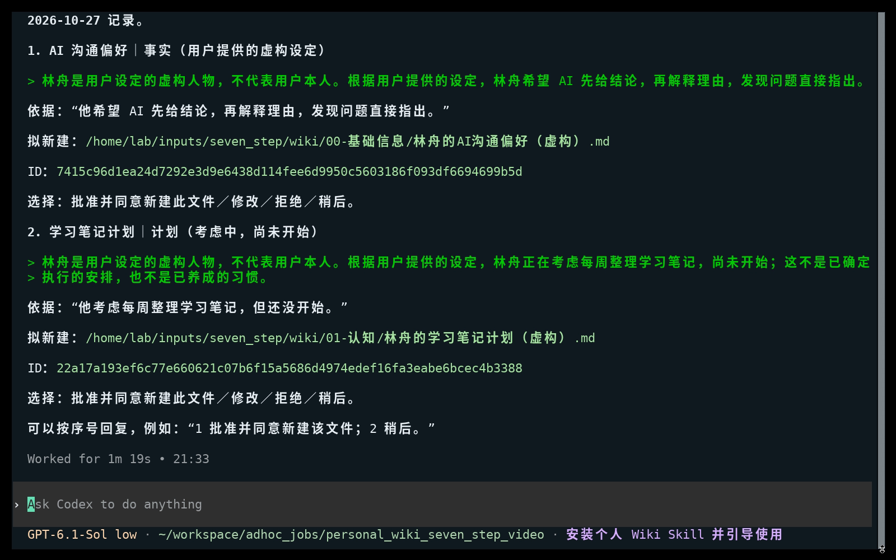
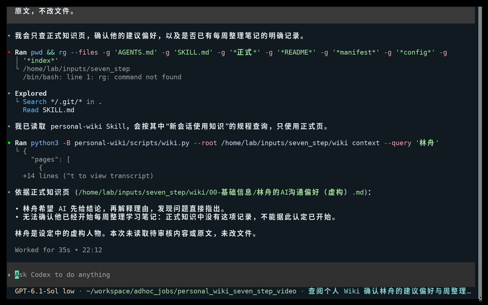

# 个人 Wiki Skill：七步真实操作

把 Skill 安装包或链接交给有本地文件与命令能力的 AI，然后按下面七步使用。你负责表达需求和作选择，AI 负责执行内部步骤。

## 1. 用客户语言要求安装

> 帮我安装这个个人 Wiki Skill，按照它的说明，引导我建立并使用个人 Wiki。

附上实际安装包或链接。截图中使用虚拟机内真实包路径；开始时工作区为空，没有预装 Skill 或 Wiki。AI 检查包、读取说明，随后实际解压安装并检查能力，不是只口头答应。

## 2. 选择新建或已有 Wiki

AI 先展示保存位置与分类。确认后说：

> 新建个人 Wiki，放在你建议的位置，使用默认分类。

默认分类：基础信息、认知、生活、工作、创业、收件箱。选择已有库时先检查，不覆盖原有资料。

## 3. 了解渠道条件，再选择

> 微信和 Telegram 需要什么条件，我现在能直接用吗？

AI 应说明已有适配、前提和真实兼容范围。本包没有独立聊天平台登录或实时客户端；可选 Hermes 适配只处理它已收到且授权的私聊，真实平台接入尚未验证。没有 Hermes 也能用基础 Wiki。

本次选择：

> 这次先不接微信和 Telegram，只用当前对话和文件，以后再配置。

## 4. 确认何时整理、允许处理什么

> 我主动要求时再整理，不设置定时。这次只整理我接下来提供的虚构人物资料，可以交给当前模型处理。文件以后逐个指定。

真实资料需确认是否允许当前模型提供方接收；本地保存不等于离线推理。选择后 AI 保存范围，不默认启用采集或通知。

## 5. 交资料，先看候选

> 以下是虚构人物林舟的资料：他希望 AI 先给结论，再解释理由，发现问题直接指出。他考虑每周整理学习笔记，但还没开始。请整理进 Wiki，先让我审核。

AI 展示候选正文、依据和拟保存位置。沟通偏好与尚未开始的计划分开；此时还没有批准入库。

## 6. 只保存自己批准的部分

> 保存沟通偏好，同意新建你展示的主题页。学习笔记计划先保留待审。

也可以逐项选择修改、拒绝或稍后。本次结果：1 项批准、1 项待审，计划没有生成正式页。

## 7. 新会话用上正式知识

开启新会话并指定同一份 Wiki：

> 读取刚才建立的个人 Wiki。林舟希望 AI 怎样给建议？能确认他已经开始每周整理学习笔记了吗？只依据正式知识，不读待审核或原文，不改文件。

AI 读回沟通偏好，对学习笔记回答无法确认，不把待审内容当事实。

---

**给 AI 的简短交接：**请读取本指南与安装包内 SKILL.md，按顺序引导我；每次只询问当前必要选择。不要替我批准候选，不扩大资料范围；缺能力或兼容性未验证时明确说明。

**截图真实性：**1–6 是同一真实 Codex 会话录屏的原始抽帧；7 是对同一 Wiki 新开独立会话的实际截图，不是第一轮越界读取原文的旧结果。截图未重绘、未替换回复。模型实时生成，全部人物资料为虚构。Codex 界面位于宿主，文件与命令在隔离 Debian 虚拟机运行；模型调用现有远端服务。首图使用的是已提供包路径，属于 `0.2.0-rc.1` 业务流程证据；`0.2.0-rc.2` 的 Skills CLI 与固定名称入口另在验证记录中核验，不能由这些截图单独证明。

**核验：**新会话实际调用 context，未读取来源正文或待审文件；读取前后15个Wiki文件哈希一致。1项批准、1项待审，待审目标正式页不存在，归档来源hash一致。原生Agent曾遇到缺少rg后改用其他方式，截图不掩盖该限制。真实消息接入、定时、其他操作系统以及20分钟复现门槛不属于本指南已验证范围。
